# Activité 5 : CI/CD sécurisé

Pipeline GitHub Actions pour `portfolio-next` (frontend Next.js), `api` (Express + Prisma) et `release` (semantic-release). Workflows : `ci.yml`, CodeQL, Dependabot, `commits.yml` (Conventional Commits) et `release.yml`. Les captures sont dans `captures/`.

## Avancement

| Tâches | Sujet | État |
|---|---|---|
| 70 | Tests frontend et API | Fait |
| 71 | Secrets, SAST, dépendances | Fait |
| 72, 73 | Build des images, scan Trivy | Fait (réserve : voir section 3) |
| 74 | CodeQL et comparaison avec Semgrep | Tableau à compléter (alertes CodeQL) |
| 75 | Dependabot | Fait |
| 76, 77 | Permissions, pinning par SHA | Fait |
| 78 | Comparaison avec Jenkins | Fait |
| 79 à 83 | Git workflow, protection de `main`, Conventional Commits, SemVer | Fait (contrôle Conventional Commits à ajouter aux contrôles requis) |
| 84 | semantic-release | Fait |
| 85 à 87 | Mesures avant/après, Dockerfile multi-stage de l'API | Fait |
| 88, 89 | Buildx, image multi-architecture | Fait |
| 90 à 95 | Harbor | À faire |
| 96 à 105 | SBOM, Cosign, attestations, SLSA, attaque simulée | À faire |

---

## 1. Tests CI (tâche 70)

Le workflow `ci.yml` lance les tests du frontend et de l'API sur chaque `push` sur `main` et sur chaque `pull_request`. Premier run vert sur la PR #1.

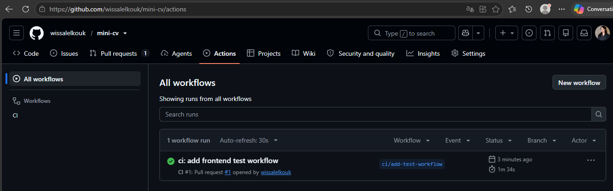

## 2. Secrets, SAST et audit des dépendances (tâche 71)

`ci.yml` contient six jobs : tests frontend, tests API, scan des secrets (Gitleaks), SAST (Semgrep), audit des dépendances (`npm audit`) et build des images Docker avec scan Trivy. Au premier essai, Semgrep et Trivy sont rouges.

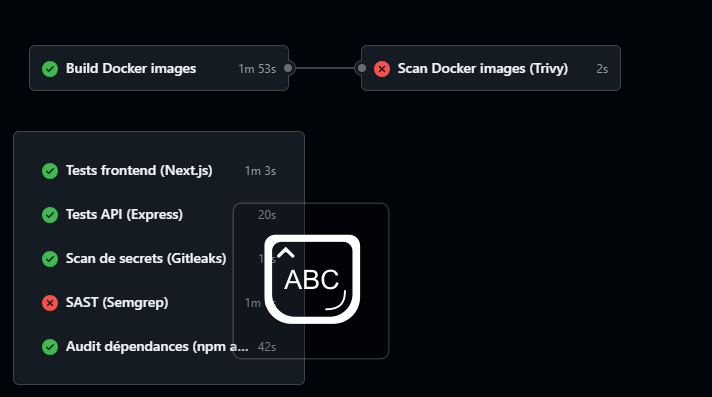

**Semgrep** : 20 findings bloquants au premier run.

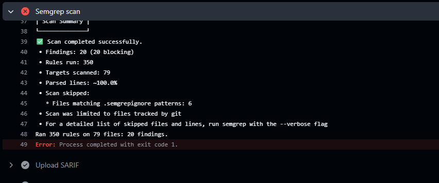

Au run suivant, Semgrep signale 16 findings, tous de la même règle : des actions référencées par un tag modifiable au lieu d'un SHA de commit. Ils sont corrigés par le pinning (section 9).

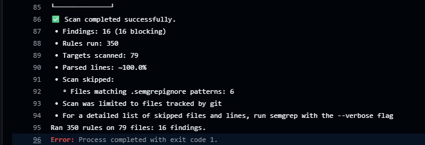

## 3. Build des images et scan Trivy (tâches 72, 73)

Les deux images (frontend et API) sont construites avec Buildx, puis scannées par Trivy. Les rapports sont affichés dans le log et envoyés au format SARIF à l'onglet Security.

**Problèmes rencontrés :**

1. Le premier job de scan lançait Trivy sur des images construites dans un autre job. Chaque job tourne sur un nouveau runner : les images n'existent pas. Le build et les scans sont maintenant dans un seul job, `build-and-scan-images`.
2. L'action `trivy-action` a ensuite cessé de fonctionner : `@0.24.0` échoue en quelques secondes, et `@0.35.0` échoue à l'installation (code 6). Les fichiers `trivy-api.sarif` et `trivy-frontend.sarif` ne sont pas créés, et les étapes d'envoi échouent à leur tour.
3. Correction : Trivy est lancé depuis l'image officielle `ghcr.io/aquasecurity/trivy:0.69.3` avec `docker run`, sans action tierce. Les envois SARIF ne s'exécutent que si le fichier existe.

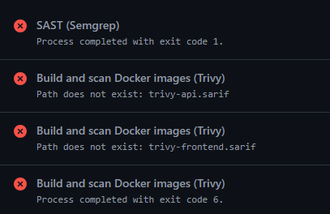

Systèmes détectés dans les images : frontend sur Alpine 3.24.3, API sur Debian 12.15.

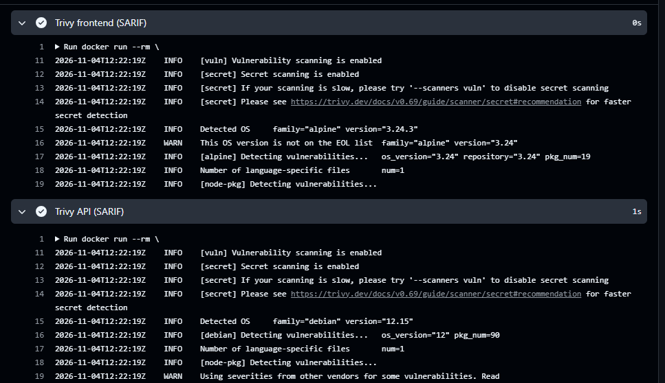

Résultats Trivy (vulnérabilités HIGH et CRITICAL par image) : à compléter.

**Limites actuelles :**

- les étapes Trivy utilisent `--exit-code 0` : le job échoue si Trivy plante, mais pas à cause d'une vulnérabilité ;
- l'image Trivy est référencée par un tag, pas par un digest.

## 4. CodeQL et comparaison avec Semgrep (tâche 74)

CodeQL est activé sur le dépôt. Il analyse les workflows (`actions`) et le code (`javascript-typescript`) sur chaque PR et chaque push sur `main`.

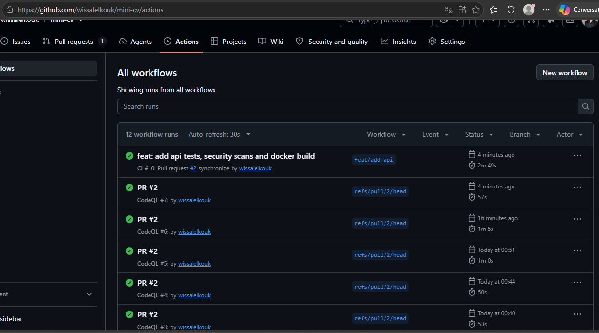
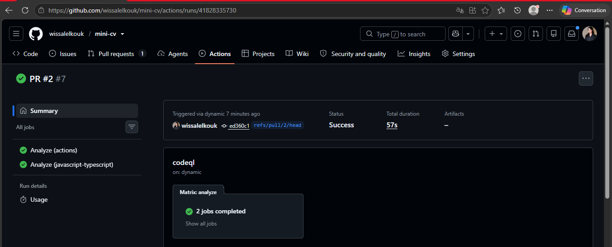
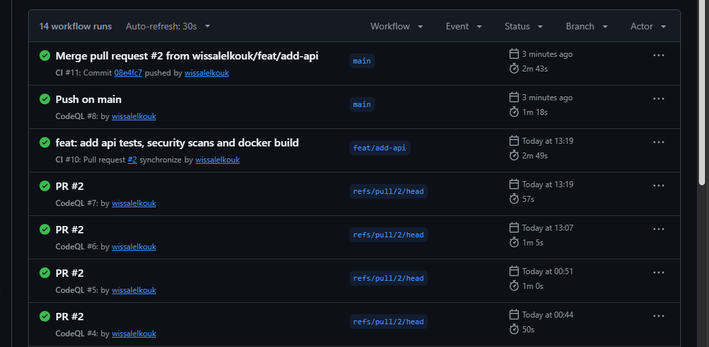

| Sujet | Semgrep | CodeQL |
|---|---|---|
| Actions référencées par un tag mutable (`ci.yml`) | 16 alertes, une seule règle | à compléter |
| Configuration Dependabot sans `cooldown` | 5 alertes (une règle, 5 blocs) | à compléter |
| Code applicatif (API, Next.js) | 0 alerte | à compléter |
| Périmètre | règles `p/ci`, `p/javascript`, `p/typescript`, `p/owasp-top-ten` | analyses `actions` et `javascript-typescript` |

## 5. Dependabot (tâche 75)

La PR #3 ajoute `.github/dependabot.yml`. Son premier run échoue sur Semgrep, qui relève 5 findings sur la configuration (pas de `cooldown`). Après ajout d'un `cooldown` de 7 jours à chaque bloc, le run suivant est vert.

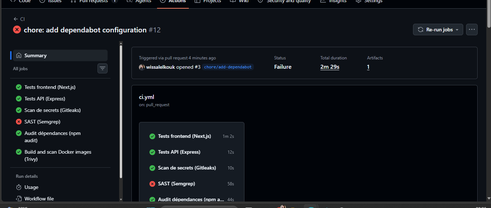
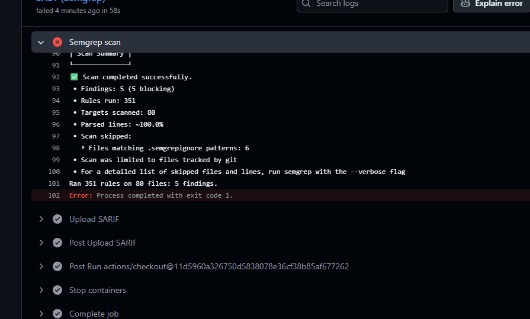
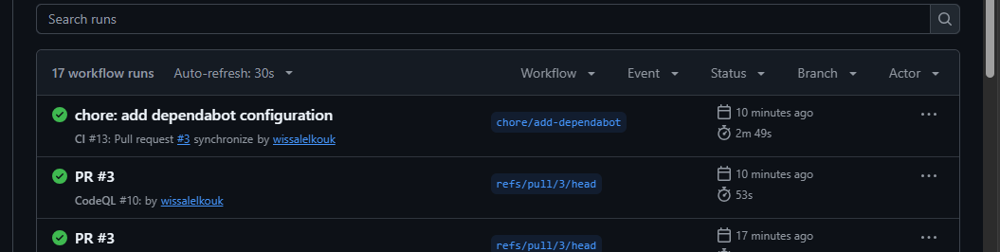

Dependabot surveille `portfolio-next`, `api`, les workflows GitHub Actions et les deux Dockerfile. L'onglet Dependency graph propose aussi un export SBOM.

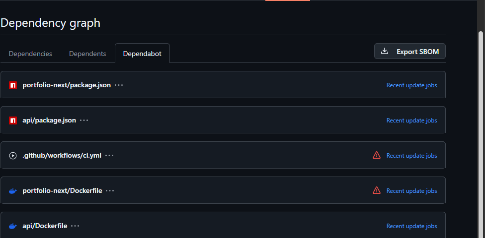

Exemple de PR ouverte automatiquement par Dependabot (image `node` 22-alpine vers 25-alpine) :

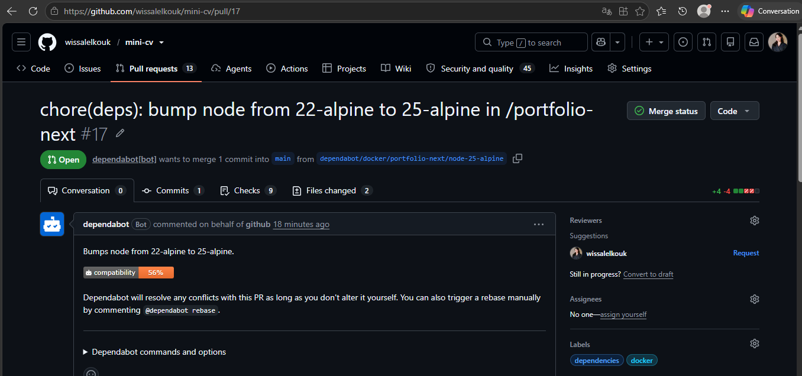

Certaines PR échouent sur les contrôles obligatoires, ce qui est le comportement voulu : une montée de version qui casse le projet n'est pas fusionnée.

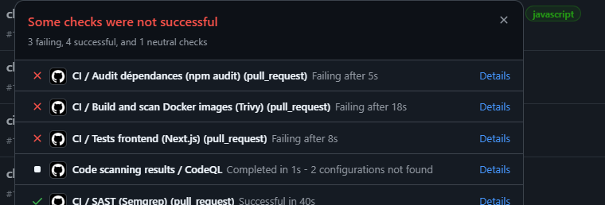

Trois exemples de cassures :

- `npm ci` échoue sur un conflit de dépendances (`ERESOLVE`) quand `react-dom` est mis à jour seul ;
- les tests du frontend échouent car `react` et `react-dom` n'ont pas la même version ;
- le build de l'image API échoue à l'étape `RUN npx prisma generate`.

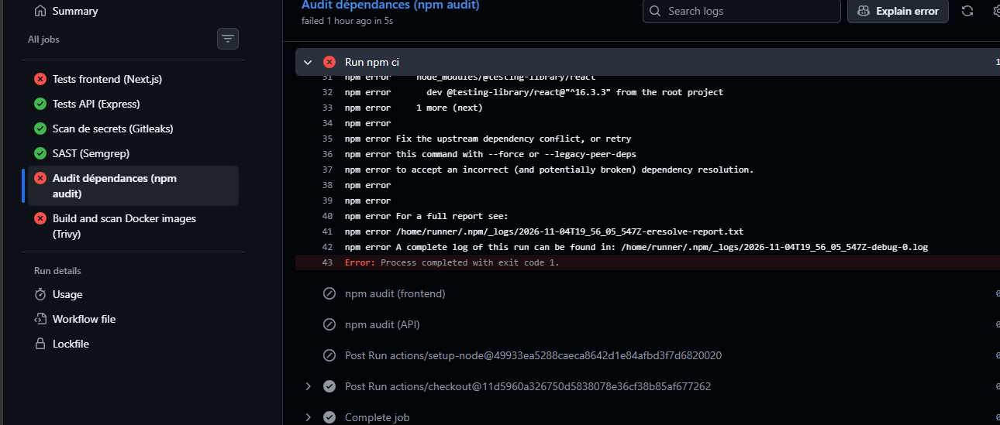
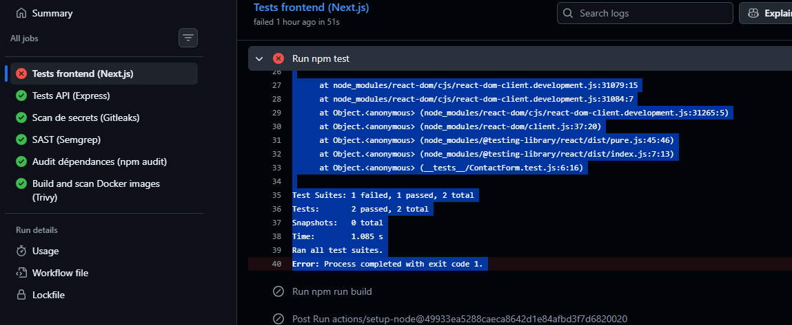
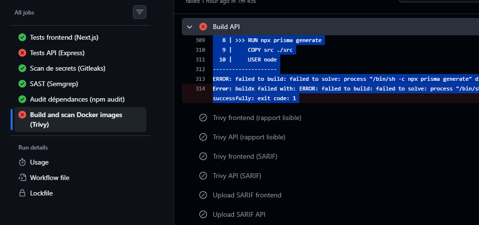

Correction (PR #18) : `react` et `react-dom` sont mis à jour dans le même groupe, de même que `prisma` et `@prisma/*`, et les montées de version majeure de `node` sont ignorées pour les deux Dockerfile.

## 6. Git workflow (tâches 79 à 83)

### Convention de nommage des branches (tâche 79)

Format `<type>/<description-courte-en-kebab-case>`, avec les types de Conventional Commits : `feat/`, `fix/`, `ci/`, `chore/`, `docs/`. Exemples du dépôt : `ci/add-test-workflow`, `feat/add-api`, `chore/add-dependabot`, `ci/make-audit-blocking`, `fix/dockerfile-duplicate-env`. Dependabot crée ses branches sous la forme `dependabot/<écosystème>/<paquet>`.

Le flux est : branche, Pull Request, contrôles, fusion.

### Protection de `main` (tâche 80)

Le ruleset `protect-main` est actif, avec 4 règles sur `main`, dont : pas de suppression de la branche, Pull Request obligatoire avant fusion et contrôles obligatoires. La liste de contournement (bypass) est vide, donc la règle s'applique aussi au propriétaire du dépôt.

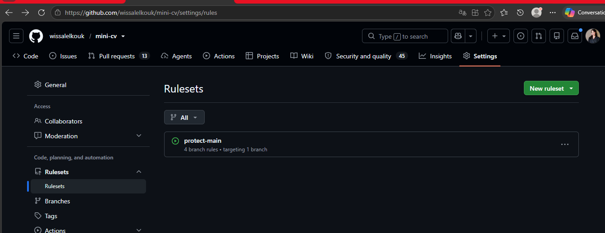
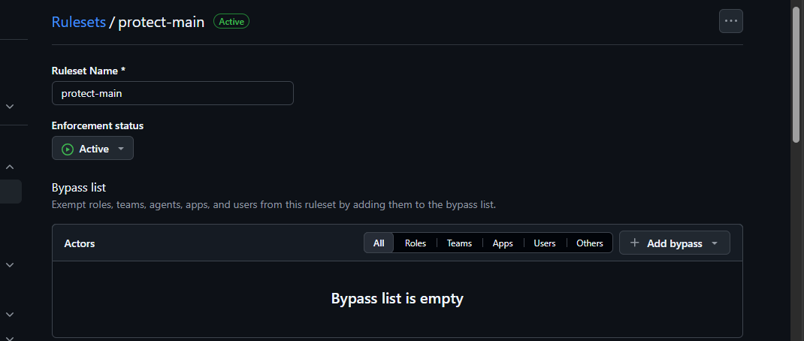
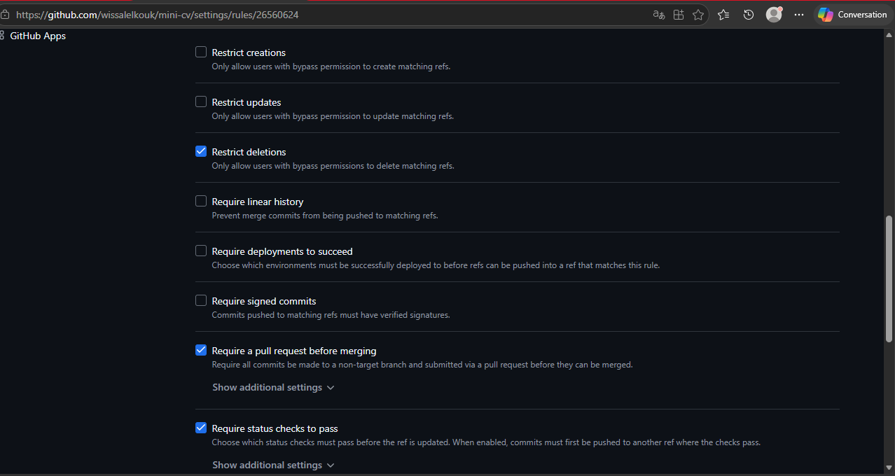

**Test : push direct refusé.** Un commit vide poussé sur `main` est rejeté (`GH013`) : les changements doivent passer par une Pull Request et les 6 contrôles obligatoires doivent être verts.

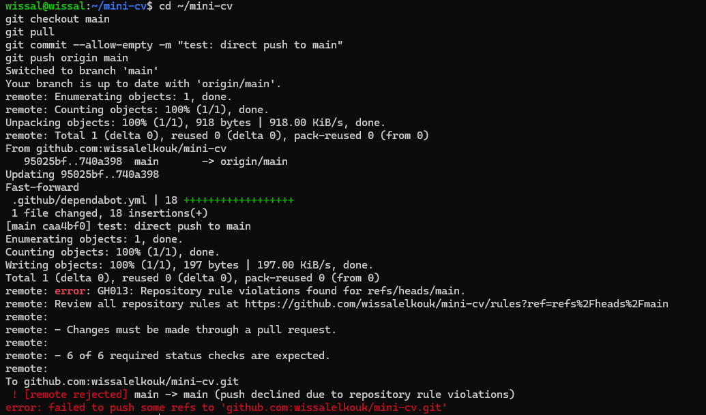

### Contrôles obligatoires avant fusion (tâche 81)

Six contrôles sont requis : tests frontend, tests API, scan des secrets, SAST, audit des dépendances, build et scan des images. Le contrôle Conventional Commits, apparu avec `commits.yml`, reste à ajouter à cette liste.

Tant que les contrôles ne sont pas passés, GitHub refuse la fusion.

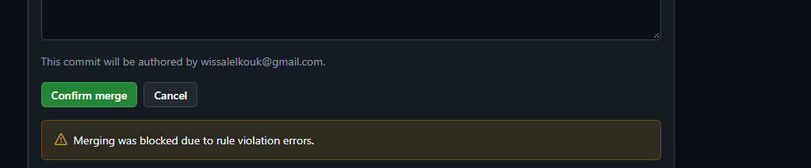

La PR #21 rend le job `npm audit` bloquant (suppression de `continue-on-error`). Elle est fusionnée avec ses contrôles verts.

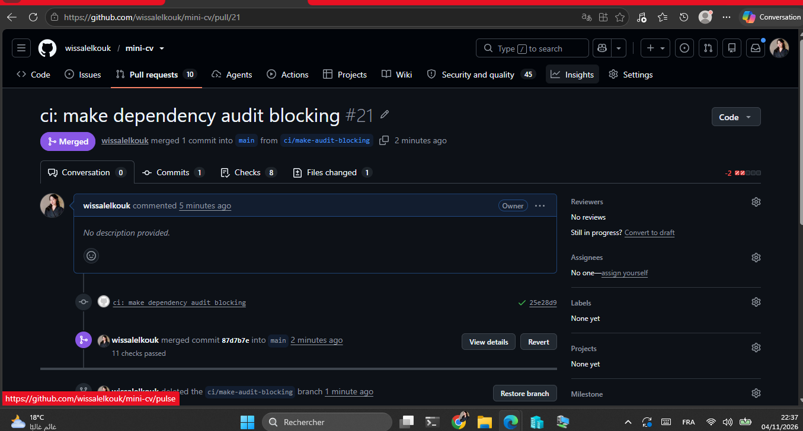

La PR #23 (`fix(deps): update release dependencies and audit them in ci`) ajoute l'audit du dossier `release/`. Elle est **bloquée par un contrôle en échec** : « Audit dépendances » est rouge, les 11 autres sont verts, et le bouton de fusion est désactivé.

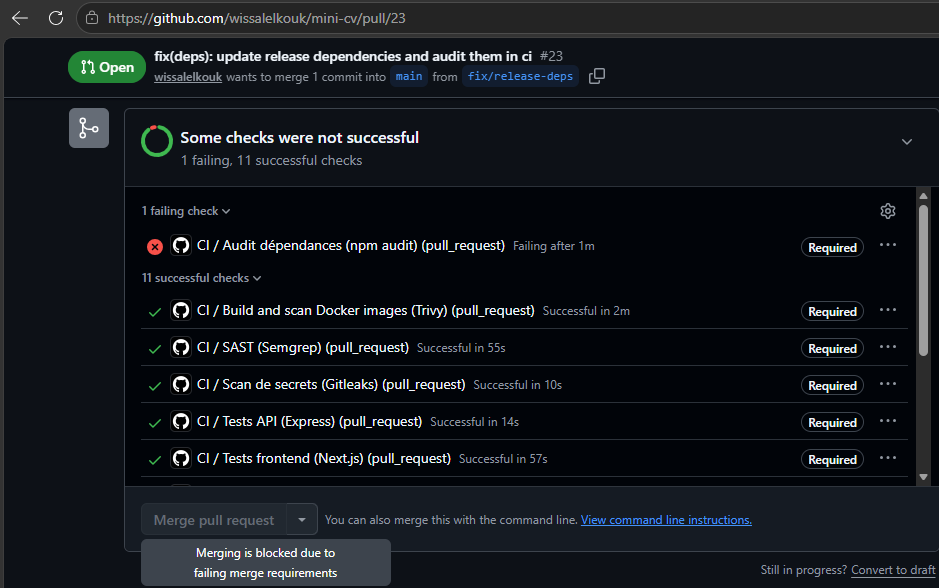

Le log montre 37 vulnérabilités (36 moderate, 1 high), dont `undici`, toutes sous `node_modules/npm/node_modules/`.

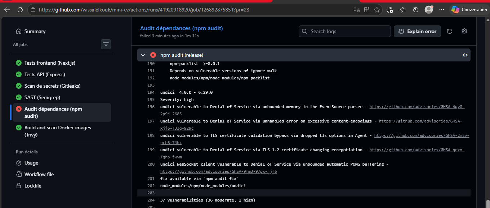

### Exception d'audit documentée

| Point | Contenu |
|---|---|
| Constat | 1 alerte high (`undici`) et 36 moderate, toutes sous `node_modules/npm/node_modules/` |
| Origine | `npm@11.21.1` embarqué dans `@semantic-release/npm@13.2.0`, dépendance de `semantic-release@25.0.9` |
| Pas de correction possible | `npm audit fix` ne modifie pas un paquet embarqué ; un override vers `npm@12.2.1` n'a rien changé (audit identique) |
| Pourquoi c'est acceptable | `.releaserc.json` ne charge que `commit-analyzer`, `release-notes-generator` et `github` : le plugin npm n'est pas utilisé (lecture de la configuration, pas test d'exécution) |
| Garde-fou | `.github/scripts/audit-release.js` reste bloquant pour toute autre alerte high ou critical et affiche ce qu'il ignore |

### Conventional Commits (tâche 82)

Le workflow `commits.yml` vérifie le message de chaque commit d'une Pull Request (types `feat`, `fix`, `docs`, `style`, `refactor`, `perf`, `test`, `build`, `ci`, `chore`, `revert`, avec `!` possible). Les préfixes de Dependabot (`chore(deps)`, `ci(deps)`) respectent ce format.

### Semantic Versioning (tâche 83)

Versions `MAJOR.MINOR.PATCH` : `fix` donne un PATCH, `feat` un MINOR, `feat!` ou `BREAKING CHANGE` un MAJOR. Les types `ci`, `chore` et `docs` ne déclenchent pas de release.

## 7. Release automatique (tâche 84)

`release.yml` lance semantic-release à chaque push sur `main` (plugins `commit-analyzer`, `release-notes-generator`, `github`). Il n'écrit aucun commit sur `main`, car le ruleset l'interdit : le changelog est dans la note de la release GitHub. Seul ce job reçoit `contents: write`. Les outils sont installés par `npm ci` depuis un `package-lock.json` verrouillé.

Le workflow Release s'exécute à chaque fusion sur `main`. Il publie une version seulement si un commit `feat:` ou `fix:` est arrivé : la fusion de la PR #24 (`fix: remove duplicated NODE_OPTIONS in frontend Dockerfile`) a produit le tag `v1.0.0` (run Release #2, commit `1a4c004`). Les autres fusions ne contiennent que des commits `ci:`, `docs:` ou `build:` : leur run est vert et ne publie rien, ce qui est le comportement attendu.

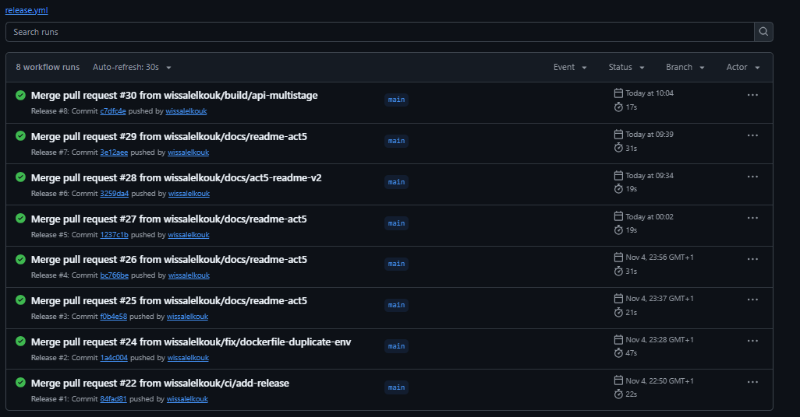

Les runs « Dependabot Updates » en échec sur `/release` (`undici`, `minimatch`) portent sur les mêmes paquets que l'exception d'audit de la section 6.

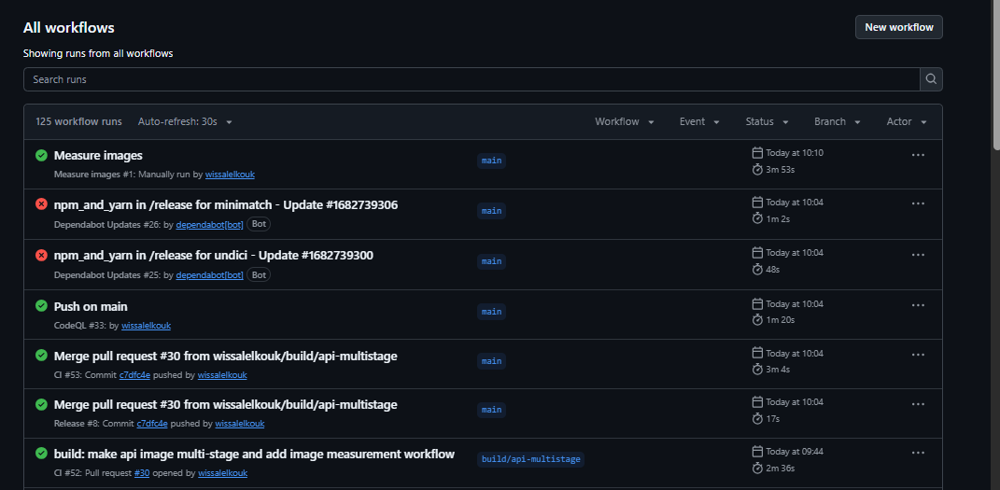

La PR #23 (`fix(deps): update release dependencies and audit them in ci`) a ensuite produit le tag `v1.0.1`, une version PATCH (commit de type `fix`), avec une note « Bug Fixes » générée automatiquement. La page Releases liste `v1.0.0` et `v1.0.1`.

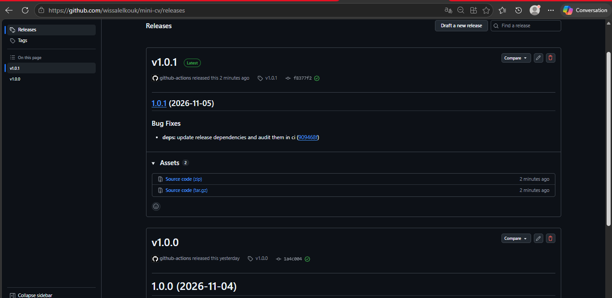
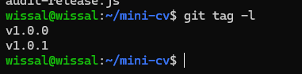

## 8. Permissions du `GITHUB_TOKEN` (tâche 76)

`ci.yml` déclare `permissions: contents: read` pour tout le workflow. Chaque job n'ajoute que ce dont il a besoin : `security-events: write` pour l'envoi SARIF (Semgrep et Trivy), et `contents: write` (avec `issues` et `pull-requests`) uniquement pour le job Release.

## 9. Pinning par SHA et surface d'attaque (tâche 77)

Toutes les actions tierces sont référencées par un SHA de commit, avec la version en commentaire.

| Action | Version | SHA |
|---|---|---|
| `actions/checkout` | v4 | `11d5960a326750d5838078e36cf38b85af677262` |
| `actions/setup-node` | v4 | `49933ea5288caeca8642d1e84afbd3f7d6820020` |
| `docker/setup-buildx-action` | v3 | `8d2750c68a42422c14e847fe6c8ac0403b4cbd6f` |
| `docker/build-push-action` | v5 | `ca052bb54ab0790a636c9b5f226502c73d547a25` |
| `github/codeql-action/upload-sarif` | v4 | `1fc58d04a4d4374f921bdac573c3811c240f9c26` |
| `gitleaks/gitleaks-action` | v2 | `ff98106e4c7b2bc287b24eaf42907196329070c7` |

Semgrep a signalé les 16 références par tag (règle `github-actions-mutable-action-tag`). Dependabot met à jour ces SHA grâce au commentaire de version.

**Pourquoi la chaîne CI/CD est elle-même une surface d'attaque.** Un pipeline s'exécute avec des secrets et un jeton qui peut écrire dans le dépôt. Une action tierce, une image ou une dépendance du pipeline s'exécute avec ces droits : si elle est compromise, l'attaquant exécute du code dans notre chaîne de livraison. Un tag peut être déplacé par le propriétaire de l'action, un SHA de commit non. Cela justifie de réduire les permissions, d'épingler les versions et de contrôler les dépendances du pipeline lui-même (audit de `release/`). Cas vécu ici : la dépendance à `trivy-action` a cassé le pipeline, puis Trivy a été lancé depuis son image officielle.

## 10. Comparaison avec Jenkins (tâche 78)

| Critère | Jenkins (activité 4) | GitHub Actions |
|---|---|---|
| Exécution | serveur à installer et à maintenir sur la VM | runners hébergés par GitHub |
| Configuration | `Jenkinsfile` (Checkout, Install dependencies, Build) | YAML dans `.github/workflows` |
| Déclenchement | à configurer | `push` et `pull_request` natifs |
| Intégration aux branches | pas de lien avec les règles de fusion | contrôles obligatoires via le ruleset |
| Sécurité | secrets et plugins à gérer sur la VM | permissions du jeton par job, actions épinglables par SHA |

## 11. Optimisation des images (tâches 85 à 89)

Le workflow `measure-images.yml` (déclenchement manuel) construit les quatre images sans cache, relève leur taille et leur temps de build, puis les scanne avec Trivy 0.69.3 (vulnérabilités HIGH et CRITICAL). Toutes les mesures sont faites dans les mêmes conditions, sur un runner GitHub : les temps ne sont pas comparables à ceux d'une VM locale.

- **API** : le Dockerfile d'origine (une seule étape, conservé dans `act5/measures/Dockerfile.api-before`) est comparé au Dockerfile multi-stage actuel (`api/Dockerfile`).
- **Frontend** : le Dockerfile du frontend était déjà multi-stage. L'état « avant » est un Dockerfile mono-étape de référence (image `node:22`, `act5/measures/Dockerfile.frontend-before`), écrit pour la comparaison.

| Image | Taille | Temps de build | HIGH | CRITICAL |
|---|---|---|---|---|
| API avant (mono-étape) | 564 Mo | 18 s | 45 | 1 |
| API après (multi-stage) | 460 Mo | 15 s | 45 | 1 |
| Frontend avant (référence mono-étape) | 1 932 Mo | 75 s | 528 | 20 |
| Frontend après (multi-stage) | 223 Mo | 64 s | 10 | 0 |

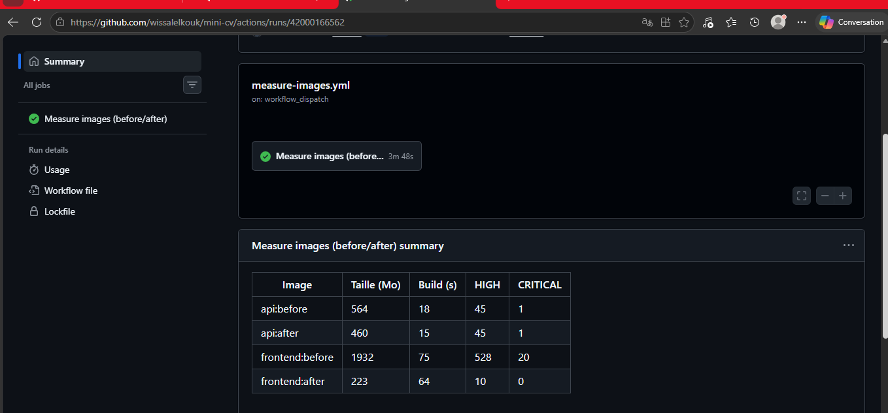

Le multi-stage réduit fortement l'image du frontend : la compilation de Next.js se fait dans une étape intermédiaire et l'image finale ne contient que le résultat (`standalone`). Pour l'API, le gain de taille est modeste (environ 18 %) et le nombre de vulnérabilités est identique : elles viennent de l'image de base Debian et des dépendances, que le multi-stage ne modifie pas. Les totaux comptent des entrées du rapport Trivy, pas des CVE uniques.

Vérification de démarrage : l'image multi-stage de l'API a été lancée avec `docker compose` et sa base PostgreSQL. Les deux conteneurs sont restés `healthy` pendant plusieurs heures, la migration Prisma s'est appliquée (`prisma migrate deploy` s'exécute au démarrage) et le serveur répond sur le port 4000 (en-têtes Helmet présents ; la route `/health` n'existe pas, la réponse est un 404 JSON).

### BuildKit et Buildx (tâche 88)

BuildKit est utilisé pour tous les builds. En local : Buildx v0.37.1, builder `default` (driver `docker`), BuildKit v0.33.0, plateforme `linux/amd64`. Dans la CI, `docker/setup-buildx-action` crée un builder `docker-container`.

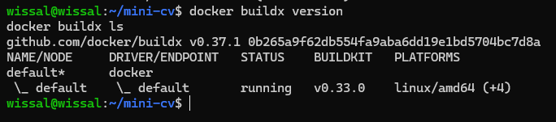

### Image multi-architecture (tâche 89)

Le workflow `multiarch.yml` (déclenchement manuel) construit l'image de l'API pour `linux/amd64` et `linux/arm64` (émulation QEMU sur un runner GitHub) et la publie sur GitHub Container Registry : `ghcr.io/wissalelkouk/mini-cv-api:multiarch`. Seul ce job reçoit la permission `packages: write`, et les actions sont épinglées par SHA. Seule l'image de l'API est construite en multi-architecture : l'émulation `arm64` rendrait le build du frontend très long.

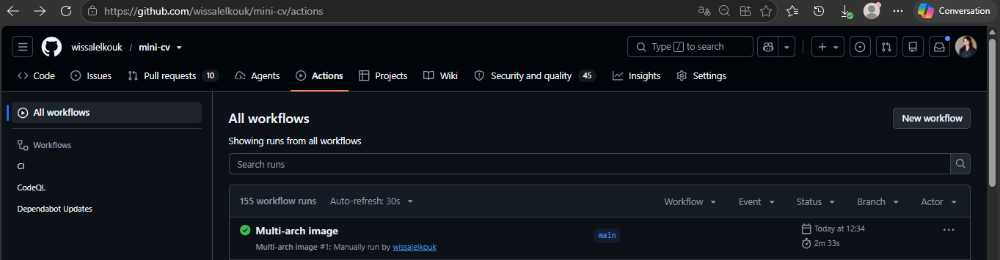

Résultat de `docker buildx imagetools inspect ghcr.io/wissalelkouk/mini-cv-api:multiarch` :

```
Name:      ghcr.io/wissalelkouk/mini-cv-api:multiarch
MediaType: application/vnd.oci.image.index.v1+json
Digest:    sha256:5138efbff8d1ecb97c96ba16da371f0f34b2de16dfe81c293ea86e0db0836fb0

Manifests:
  Name:        ghcr.io/wissalelkouk/mini-cv-api:multiarch@sha256:9dca570253fddec39da4a146544d7abae8c5f19e7f53b7555e6185df7a42fd9f
  MediaType:   application/vnd.oci.image.manifest.v1+json
  Platform:    linux/amd64

  Name:        ghcr.io/wissalelkouk/mini-cv-api:multiarch@sha256:98d4b6d3ceabecc61d1cd85e8557923fddef40d291c42703d389c47c5b0f67ac
  MediaType:   application/vnd.oci.image.manifest.v1+json
  Platform:    linux/arm64

  Name:        ghcr.io/wissalelkouk/mini-cv-api:multiarch@sha256:bf5647d21c6c5150a338d7a32f72f0fdfb1e8c7514de42dbdf0ae22be111dfbf
  MediaType:   application/vnd.oci.image.manifest.v1+json
  Platform:    unknown/unknown
  Annotations:
    vnd.docker.reference.digest: sha256:9dca570253fddec39da4a146544d7abae8c5f19e7f53b7555e6185df7a42fd9f
    vnd.docker.reference.type:   attestation-manifest

  Name:        ghcr.io/wissalelkouk/mini-cv-api:multiarch@sha256:61ee8362044ac7894b17c8683c7068d0a5c6bef23724f59f7ad4fed5ccba7c71
  MediaType:   application/vnd.oci.image.manifest.v1+json
  Platform:    unknown/unknown
  Annotations:
    vnd.docker.reference.digest: sha256:98d4b6d3ceabecc61d1cd85e8557923fddef40d291c42703d389c47c5b0f67ac
    vnd.docker.reference.type:   attestation-manifest
```

L'index contient les deux architectures. Les deux entrées `unknown/unknown` ne sont pas des plateformes : ce sont les manifestes d'attestation que BuildKit joint à chaque image (un par architecture). Elles serviront aux tâches sur les attestations et la provenance.

## 12. Registre privé Harbor (tâches 90 à 95)

À faire.

## 13. Software Supply Chain Security (tâches 96 à 105)

À faire : SBOM avec Syft, signature Cosign, attestations de build, provenance, SLSA et simulation d'attaque.

## Difficultés rencontrées

| Problème | Cause | Solution |
|---|---|---|
| Workflow invalide (« Invalid workflow file ») | Mauvaise indentation après un collage | Vérification de la syntaxe YAML avant chaque push |
| Tests frontend en échec | Test écrit pour Jest, script remplacé par Vitest | Retour au script Jest d'origine |
| Trivy en échec en quelques secondes | Images construites dans un autre job, puis `trivy-action` indisponible | Build et scan dans un même job, Trivy lancé depuis son image officielle |
| 16 alertes Semgrep | Actions référencées par tag | Pinning par SHA |
| PR Dependabot cassées | `react` et `react-dom` mis à jour séparément | Groupes dans `dependabot.yml` |
| Audit de `release/` en échec | `undici` embarqué dans le `npm` d'un plugin non utilisé | Exception limitée et documentée |
