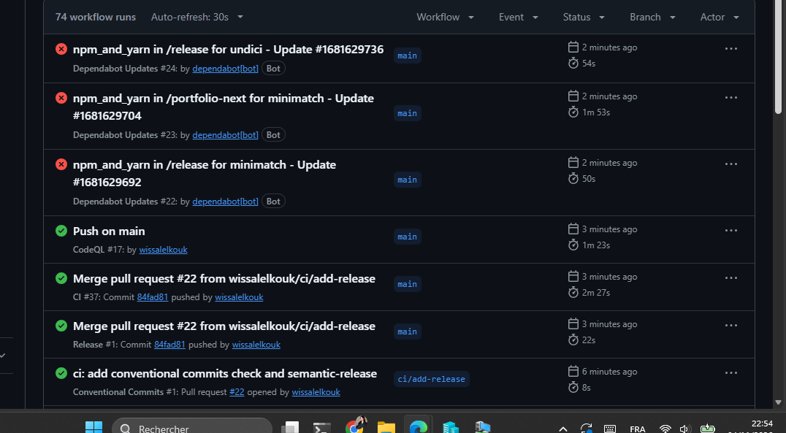

## Activité 5 : CI/CD sécurisé

Pipeline GitHub Actions pour `portfolio-next` (frontend Next.js), `api` (Express + Prisma) et `release` (semantic-release). Workflows : `ci.yml`, CodeQL, Dependabot, Conventional Commits et Release. Les captures sont dans `captures/`.

### 1. Tests CI (tâche 70)
Le workflow `ci.yml` lance les tests du frontend à chaque `push` et `pull_request`. Premier run vert sur la PR #1.

### 2. Scan des secrets, SAST et scan des images (tâches 71, 73)
Le pipeline contient six jobs : tests frontend, tests API, scan des secrets (Gitleaks), SAST (Semgrep), audit des dépendances (`npm audit`) et build des images Docker avec scan Trivy. Au premier essai, Semgrep et Trivy sont rouges.

**Semgrep** : 20 findings bloquants au premier run.

**Trivy** : les fichiers `trivy-api.sarif` et `trivy-frontend.sarif` n'existent pas, car le scan s'arrête avec le code 6 avant de les écrire.

**Correction** : Semgrep passe de 20 à 16 findings. Ils concernent les actions référencées par des tags mutables au lieu d'un SHA.

Les actions sont ensuite épinglées par SHA (par exemple `actions/checkout@11d5960a…` dans le log de la capture 11), ce qui rejoint la tâche 77.

### 3. Scan Trivy des images (tâche 72)
Les deux images sont scannées : le frontend (Alpine 3.24.3) et l'API (Debian 12.15). Les rapports SARIF sont envoyés à l'onglet Security.

### 4. CodeQL (tâche 75)
CodeQL analyse les workflows (`actions`) et le code (`javascript-typescript`) sur chaque PR et chaque push sur `main`.

### 5. Dependabot (tâche 74)
La PR #3 ajoute `.github/dependabot.yml`. Son premier run échoue sur Semgrep, qui relève 5 findings sur la configuration Dependabot (cooldown). Une fois corrigés, le run suivant est vert.

Dependabot surveille `portfolio-next`, `api`, les workflows GitHub Actions et les deux Dockerfile. L'onglet Dependency graph propose aussi un export SBOM.

Exemple de PR ouverte par Dependabot (image `node` 22-alpine vers 25-alpine) :

Certaines PR de Dependabot échouent sur les contrôles obligatoires, ce qui est le comportement voulu : une montée de version qui casse le projet n'est pas fusionnée.

Trois exemples de cassures :
- `npm ci` échoue sur un conflit de dépendances (`ERESOLVE`, pair `@testing-library/react`) ;
- les tests du frontend échouent à cause de la version de React (suite `ContactForm.test.js`) ;
- le build de l'image API échoue à l'étape `RUN npx prisma generate` du Dockerfile.

### 6. Protection de la branche `main` (tâches 79 à 83)
Le ruleset `protect-main` est actif, avec 4 règles sur `main`, dont : pas de suppression de la branche, Pull Request obligatoire avant fusion et contrôles obligatoires. La liste de contournement (bypass) est vide, donc la règle s'applique aussi à moi.

**Test 1 : fusion bloquée.** Tant que les contrôles ne sont pas passés, GitHub refuse la fusion.

**Test 2 : push direct refusé.** Un commit vide poussé sur `main` est rejeté (`GH013`) : les changements doivent passer par une Pull Request, et les 6 contrôles obligatoires doivent être verts.

### 7. Audit des dépendances bloquant (tâche 81)
La PR #21 rend le job `npm audit` bloquant. Elle est fusionnée avec ses contrôles verts (11 checks).

La PR #23 (`fix(deps): update release dependencies and audit them in ci`) est ensuite bloquée : le contrôle « Audit dépendances » est rouge, les 11 autres sont verts, et le bouton de fusion est désactivé.

Le log montre 37 vulnérabilités (36 moderate, 1 high) : `undici`, sous `node_modules/npm/node_modules/`.

### 8. Release automatique (tâche 84)
Le workflow Release (semantic-release) se lance à la fusion sur `main`, après le contrôle Conventional Commits. Les runs rouges de Dependabot (`/release` et `/portfolio-next`) sont visibles dans la même liste.

À compléter : capture de la page Releases (tag `v1.0.0`).

### 9. Exception d'audit documentée
| Point | Contenu |
|---|---|
| Constat | 1 alerte high (`undici`) et 36 moderate, toutes sous `node_modules/npm/node_modules/` |
| Origine | `npm@11.21.1` embarqué dans `@semantic-release/npm@13.2.0`, dépendance de `semantic-release@25.0.9` |
| Pas de correction possible | `npm audit fix` ne modifie pas un paquet embarqué ; un override vers `npm@12.2.1` n'a rien changé (audit identique) |
| Pourquoi c'est acceptable | `.releaserc.json` ne charge que `commit-analyzer`, `release-notes-generator` et `github` : le plugin npm n'est pas utilisé (lecture de la configuration, pas test d'exécution) |
| Garde-fou | `.github/scripts/audit-release.js` reste bloquant pour toute autre alerte high/critical et affiche ce qu'il ignore |

### 10. Dockerfiles, mesures avant/après (tâches 85 à 89)
| Mesure | Avant | Après (multi-stage) |
|---|---|---|
| Taille de l'image | … | … |
| Temps de build | … | … |
| Vulnérabilités (Trivy) | … | … |

### 11. Harbor, SBOM, Cosign, SLSA (tâches 90 à 105)
À compléter.

### 12. Pinning par SHA et comparaison avec Jenkins (tâches 77, 78)
À compléter.
